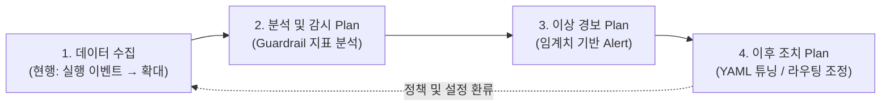
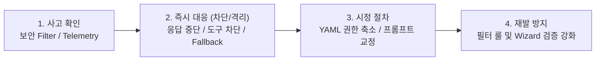

# AI Specialist 설계 과제보고서 보완 작성안 (Slide 22, 23, 29)

---

## 1. [Slide 22] 3. 유지보수 프로세스 (다이어트 및 릴리즈 초기 뉘앙스 반영본)

### 💡 수정 포인트
1. **상단 (모델·데이터 Life Cycle) 대폭 축소**: 세부 폴더 경로(`~/.cline-sr/...`) 등 지엽적인 설명은 걷어내고 **핵심 관리 체계만 개조식 1줄씩** 압축했습니다.
2. **하단 (운영 모니터링) '현행 vs 향후 고도화 계획' 분리**: 현재는 **릴리즈 초기 단계로 Perspective별 실행 이벤트(사용 빈도)만 수집 중**임을 솔직하고 명확하게 밝히고, 심사위원이 요구한 **`수집 확대 → 분석(Guardrail 지표) → 경보 → 이후 조치`**를 **단계별 운영 고도화 계획(설계안)** 뉘앙스로 풀어내어 Q&A 리스크를 완전히 없앴습니다.

---

### 📄 [Slide 22 본문 텍스트 (복사해서 바로 사용)]

#### **• AI 에이전트 Life Cycle 관리 체계**
* **AI 모델 Life Cycle**: 모든 모델 호출은 사내 `LiteLLM`을 경유하며, 에이전트 YAML 내 Step별 모델 지정 및 장애 시 Fallback 자동 전환(코드 수정 0 LOC)
* **데이터 Life Cycle**:
  * **세션 산출물**: `Memory·Dashboard·Diary` 3계층 데이터를 세션별로 분리 보관 (향후 이전 Task 기록을 재활용하여 실행 시간·시행착오 단축 예정)
  * **에이전트 YAML**: Wizard로 검증·생성된 사용자 정의 YAML을 사내 GitHub Repo에 수집·버전 관리 추진

#### **• 운영 모니터링 체계 및 고도화 계획 (Guardrail 지표 기반)**
* **[현행 (릴리즈 초기)]** 에이전트 활용도 파악을 위해 **Perspective별 실행 이벤트(사용 통계)**를 사내 텔레메트리 서버로 수집 중
* **[향후 계획]** 사내 확산에 맞춰 가드레일(Guardrail) 지표를 추가 수집하고, **분석 → 경보 → 조치로 이어지는 능동적 운영 체계 적용 예정**

아래 다이어그램은 현재의 실행 이벤트 수집 단계에서 향후 분석·경보·사후 조치로 확장되는 운영 모니터링 파이프라인을 나타냅니다.

| 구분 | 단계별 운영 모니터링 및 조치 계획 (수집 → 분석 → 경보 → 조치) |
| :--- | :--- |
| **1. 수집 항목 확대** *(현행 → 계획)* | • **[현행]** Perspective별 실행 횟수/빈도 등 기본 사용량 이벤트 수집 • **[수집 확대 계획]** Step별 성공/실패 여부, 비인가 도구 차단 이벤트, Fallback 발동 빈도, Step별 Token 소모량 추가 수집 (`Langfuse` 연동) |
| **2. 분석 내용** *(Guardrail 지표)* | • **[제어·보안 지표]** 에이전트별 비인가 도구(`allowed_tools` 외) 호출 시도 빈도 및 인프라 보안 필터 차단 추이 분석 • **[품질·성능 지표]** 전문가 에이전트별 **Step Verification 통과율(목표 ≥90%)**, Context 초과 빈도 및 모델 응답 지연/오류율 분석 |
| **3. 경보 내용** *(Alert 기준 수립)* | • **[즉시 경보(Critical)]** 비인가 쓰기/실행 도구 연속 호출 감지 시, 특정 LLM 모델 연속 호출 실패(Fallback 임계치 도달) 시 알림 • **[주의 경보(Warning)]** 특정 에이전트 YAML의 작업 완수율이 **기준치(90%) 미만으로 하락**하거나 Step당 Token 소모 급증 시 알림 |
| **4. 이후 조치 사항** *(사후 대응 방안)* | • **[모델/인프라 조치]** 이상·지연 발생 모델은 `LiteLLM` 라우팅에서 일시 제외하고, 에이전트 YAML의 기본/Fallback 모델 설정 전환 • **[에이전트 개선 조치]** 완수율 저하 에이전트의 실패 세션(`Diary`) 분석 → **Step 세분화, 프롬프트 튜닝, 허용 도구 권한 조정** 후 재배포 |

---
---

## 2. [Slide 23] 3. AI Governance

### 💡 수정 포인트
* 템플릿 지침인 **데이터 / 모델 / Compliance** 3대 축을 깔끔하게 정리하고,
* 심사위원 코멘트인 **① AI 산출물 Risk 관리 대책**과 **② 주요 위험별 대응절차(사고 확인 → 대응 → 시정)**를 본인이 구현한 `Cline^SR` 기능(QAS-01~04) 및 인프라(`LiteLLM`·`보안 Filter`)와 연결해 구체화했습니다.

---

### 📄 [Slide 23 본문 텍스트 (복사해서 바로 사용)]

#### **• 사내 폐쇄형 AI Governance 3대 체계 (데이터 · 모델 · Compliance)**
* **[데이터] 적법성 · 개인정보 보호 · 편향성 검토**
  * **수집 적법성**: 클라이언트 Telemetry는 필수 통계 항목만 필터링하여 사내 고정 엔드포인트로 전송, 모델 사용 로그는 `LiteLLM → Langfuse`로 사내 폐쇄망 내 수집
  * **개인정보 침해 2중 방지**: ① **[클라이언트]** 사내망 외부 전송 원천 차단(CON-02) + ② **[인프라 보안 Filter]** 비밀번호·토큰 등 개인정보 입력 실시간 차단
  * **편향성 검토**: Wizard(QAS-04) 기반 표준 YAML 스키마 검증으로 설정 오류·편중을 방지하고, Step별 다중 모델 지정을 통한 특정 모델 종속 완화
* **[모델] 투명성 및 책임성 (XAI & Accountability)**
  * **투명성(XAI)**: 에이전트 수행 과정을 `Memory·Dashboard·Diary` 3계층 산출물로 기록하고, 선언적 YAML을 통해 실행 Step과 허용 도구를 명확히 가시화
  * **책임성(Accountability)**: `Custom Auth` 및 `Langfuse` 로그를 통해 사용자·세션·Step 단위의 모델 호출 및 도구 사용 이력 추적성 확보
* **[Compliance] 국내외 가이드라인 및 사내 보안 규정 준수**
  * 외부 AI 도구 사용 불가 환경 대응 사내 폐쇄 구조 및 사내 가드레일 프롬프트 강제 적용(CON-02), 인간 개입 통제(Human-in-the-Loop) 준수

#### **• AI 산출물(코드 · 명령 · 설정) Risk 관리 대책** *(★심사위원 코멘트 반영 1)*
| 구분 | AI 산출물 주요 Risk | `Cline^SR` 클라이언트 및 인프라 통제 대책 |
| :--- | :--- | :--- |
| **사전 예방** | **부적절한 에이전트 설정(YAML) 생성** | • **Wizard 기반 스키마 검증(QAS-04)**: 수동 편집 시 발생하는 모델명 오타, `allowed_tools` 누락 등 설정 결함을 생성 단계에서 차단 |
| **실행 통제** | **무단 코드 수정 및 위험 명령 실행** | • **런타임 도구 권한 강제(QAS-01)**: Read-Only 등 허용된 도구 외 비인가 도구 호출 100% 차단 + 코드 반영 전 **사용자 승인(Approve/Reject)** 적용 |
| **품질/보안 검증** | **환각(불완전 코드) 및 악성 응답 생성** | • **Step 분할 및 Verification(QAS-02)**: 단계별 검증(테스트·커버리지) 통과 시에만 진행 + **인프라 보안 Filter**로 악성코드 요청 거부 및 위반 응답 중단 |

#### **• 주요 위험별 사고 확인 · 대응 · 시정 절차** *(★심사위원 코멘트 반영 2)*

아래 다이어그램은 AI 에이전트 운영 중 위험 발생 시 탐지(사고 확인)부터 즉각 차단, 시정 조치, 재발 방지까지의 4단계 대응 절차를 나타냅니다.

| 주요 위험 시나리오 | 1) 사고 확인 (Detection) | 2) 즉시 대응 절차 (Response) | 3) 시정 및 재발방지 절차 (Correction) |
| :--- | :--- | :--- | :--- |
| **개인정보·기밀 노출 및 위반 프롬프트 유입** | • `App Serving 보안 Filter` 실시간 감지 및 `Langfuse` 위반 로그 기록 | • 해당 추론 요청 즉시 거부 및 위반 응답 스트리밍 강제 중단 | • 위반 패턴을 인프라 보안 필터 및 사내 가드레일 프롬프트 규칙에 추가 반영 |
| **에이전트의 비인가 도구 호출 시도 (권한 일탈)** | • `Cline^SR` 런타임 도구 제어기에서 `allowed_tools` 위반 호출 탐지 | • 도구 실행 즉시 차단(100% Block) 및 에이전트에 안전 대안 제시(QAS-01) | • 해당 세션 `Diary` 점검 후 에이전트 YAML의 Step 프롬프트 및 권한 명세 시정 |
| **특정 모델 이상 응답 및 Step 검증 연속 실패** | • Step Verification 실패 또는 모델 응답 오류 확인 | • 런타임 **Fallback 모델로 즉시 전환(QAS-03)** 또는 사용자 수동 개입 전환 | • 문제 모델 `LiteLLM` 라우팅 점검(SR-DI팀 협업) 및 YAML 권장 모델 갱신 |

---
---

## 3. [Slide 29] 4. 품질속성 검증 (생산성 향상 Goal 대응 문구)

### 📄 [Slide 29 반영 텍스트 (택 1)]

* **옵션 1: `QAS-05 (변경 용이성)` 검증결과 칸 하단에 추가**
  > 목표치: 에이전트 발견 등록 100%, 코드 변경 0 LOC (개발 기간 30%↑ 단축)
  > 측정결과: 사용자 정의 에이전트 런타임 발견 100%, 코드 변경 없음 확인 (산출물은 YAML 데이터 1종)
  > **- 사내 신규 에이전트 5종 PoC 결과: 기존 평균 27일(1,200 LOC) → 평균 5일(또는 6~10일, 0 LOC)로 개발 기간 약 70~80% 단축**
  >   *(※ 코딩·빌드 기간은 0일로 제거, 도메인별 Step 설계 및 프롬프트 검증 기간 포함)*

* **옵션 2: 표 바로 아래 한 줄 요약으로 추가**
  > `※ [생산성 향상 Goal 검증] 사내 신규 에이전트 5종 PoC 수행 결과, 기존 평균 27일(1,200 LOC) 대비 6~10일(코드 구현 0일 + 프롬프트 설계·검증 기간, 0 LOC) 소요로 개발 기간 약 63~78% 단축 (목표 30%↑ 달성)`
