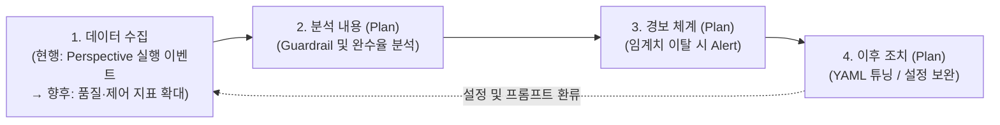
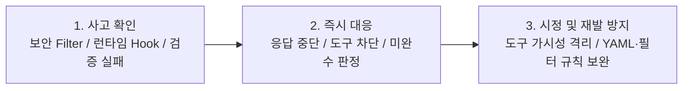

# [Slide 22 & 23] 유지보수 프로세스 및 AI Governance 최종 작성안

---

## 1. [Slide 22] 3. 유지보수 프로세스

### 📄 [Slide 22 슬라이드 본문]

#### **• AI 에이전트 Life Cycle 관리 체계**
* **AI 모델 Life Cycle**: 모든 모델 호출은 사내 `LiteLLM`을 경유하며, 전문가 에이전트 YAML에서 Step별 모델을 지정·관리
* **데이터 Life Cycle**:
  * **세션 산출물**: 실행 산출물(`Memory·Dashboard·Diary` 3계층)을 세션별로 분리 보관 (향후 이전 Task 기록을 재활용하여 실행 시간 단축 검토)
  * **에이전트 YAML**: 사용자 정의 전문가 에이전트 YAML을 사내 GitHub Repo에 수집·버전 관리 체계 검토 중

#### **• 운영 모니터링 현황 및 고도화 계획 (Guardrail 지표 기반)**
* **[현행 (릴리즈 초기)]** 초기 에이전트 활용도 파악을 위해 **Perspective별 실행 이벤트(사용 빈도 통계)**를 텔레메트리 서버로 수집 중
* **[향후 계획]** 사내 확산에 맞춰 **가드레일(Guardrail) 관련 수집 데이터를 구체화**하고, **분석 → 경보 → 사후 조치**로 이어지는 모니터링 체계 단계적 적용 계획

아래 다이어그램은 릴리즈 초기 기본 사용량 수집에서 출발하여 향후 분석·경보·사후 조치로 확장되는 운영 모니터링 계획을 나타냅니다.

| 단계 | 구분 | 상세 내용 (`현행` 및 `향후 고도화 계획`) |
| :--- | :--- | :--- |
| **1. 수집** *(현행 → 확대 계획)* | **현행 (릴리즈 초기)** | • **Perspective별 실행 이벤트 수집**: 에이전트별 호출 빈도 및 사용량 통계를 텔레메트리 수집 서버로 전송 |
| | **추가 수집 계획** | • **품질·가드레일 지표 수집 확대 검토**: Step별 Verification 통과 여부, 비인가 도구 차단 이벤트, Fallback 발생 빈도, Token 사용량 (`Langfuse` 연계) |
| **2. 분석 내용** *(수립 계획)* | **제어·보안 가드레일** | • 에이전트별 비인가 도구(`allowed_tools` 외) 호출 시도 빈도 및 인프라 보안 필터 차단 로그 분석 |
| | **품질·효율성 지표** | • 전문가 에이전트별 **작업 완수율(Step 통과율)** 추이, Context 초과 빈도 및 Step별 Token 소모량 분석 |
| **3. 경보 내용** *(수립 계획)* | **즉시 경보 (Critical)** | • 비인가 도구 연속 호출 시도 감지 시, 인프라 보안 필터 위반 임계치 초과 시 관리자 알림 |
| | **주의 경보 (Warning)** | • 특정 에이전트(YAML)의 **Step 완수율이 목표치(90%) 미만으로 하락**하거나 Step당 Token 소모 급증 시 알림 |
| **4. 이후 조치** *(수립 계획)* | **에이전트(YAML) 조치** | • 완수율 저하 에이전트의 실패 세션(`Diary`)을 분석하여 **Step 분할 조정, 프롬프트 개선, 허용 도구(`allowed_tools`) 권한 재조정** 후 배포 |

---
---

## 2. [Slide 23] 3. AI Governance

### 📄 [Slide 23 슬라이드 본문]

#### **• 모든 모델 호출은 사내 LiteLLM 경유로 사내 폐쇄 구조**
* **데이터 수집의 적법성**
  * **클라이언트**: Telemetry (필터로 필요 항목만 전송, 엔드포인트 사내 고정)
  * **인프라**: 모델 사용 로그 (`LiteLLM Gateway → Langfuse`)
* **데이터 개인정보 침해 방지**
  * **클라이언트**: 사내망 외부 전송 차단 (CON-02)
  * **인프라**: 개인정보 입력 차단 (비밀번호·토큰 등)
* **사내 규정 검토·반영 및 관리**: 사내 가드레일 프롬프트 적용 (CON-02)

---

#### **• AI 산출물(전문가 에이전트 YAML · 세션 산출물) Risk 관리 대책** *(★심사위원 코멘트 반영 1)*
| AI 산출물 구분 | 잠재적 Risk (운영 및 확산 관점) | 기술적 안전장치 및 운영 Risk 관리 대책 |
| :--- | :--- | :--- |
| **1. 전문가 에이전트 정의서** *(사용자 정의 YAML 파일)* | • 스키마 오류 또는 과도한 도구 권한(`allowed_tools`)이 부여된 미검증 YAML이 생성·배포될 위험 | • **[시스템 통제]** Wizard 기반 스키마/모델 유효성 사전 검증 및 미지원 모델 지정 시 기본 모델 자동 Fallback • **[운영 관리]** 사내 GitHub 중앙 저장소(Repo)를 통한 전사 공유 시 **최소 권한 원칙(`allowed_tools`) 및 프롬프트 적정성 PR 검수 후 공식 등록** |
| **2. 에이전트 세션 산출물** *(`Memory·Dashboard·Diary`)* | • 실행 과정의 중간 기록·코드 맥락이 최종 에이전트 결과물(워크스페이스)에 혼입되거나 외부로 유출될 위험 | • **[세션 산출물과 에이전트 결과물 분리 저장]** 내부 실행 맥락 기록인 **세션 산출물(`~/.cline-sr/data/...`)**과 실제 작업 대상인 **에이전트 결과물(프로젝트 워크스페이스)**을 물리적으로 분리 저장하여 작업 영역 오염 및 Git 오커밋 원천 방지 • **[세션 격리 및 외부 차단]** 작업 폴더·Perspective·세션별 디렉터리 격리 보관 및 사내망 외부 전송 차단(CON-02) |

---

#### **• 주요 위험별 사고 확인 · 대응 · 시정 절차** *(★심사위원 코멘트 반영 2)*

아래 다이어그램은 AI 에이전트 운영 중 주요 위험 발생 시 탐지(사고 확인)부터 즉각 차단, 시정 및 재발 방지까지의 대응 절차를 나타냅니다.

| 주요 위험 시나리오 | 1) 사고 확인 (Detection) | 2) 즉시 대응 절차 (Response) | 3) 시정 및 재발방지 절차 (Correction) |
| :--- | :--- | :--- | :--- |
| **위험 A. 개인정보·기밀 입력 및 보안 위배 프롬프트 유입** | • `App Serving 보안 Filter` 실시간 탐지 및 `Langfuse` 위반 로그 기록 | • 개인정보(비밀번호·토큰) 입력 즉시 차단, 공격/악성코드 요청 거부 및 위반 응답 중단 | • 신규 위반 패턴을 인프라 보안 필터 규칙 및 클라이언트 공통 가드레일 프롬프트(CON-02)에 업데이트 |
| **위험 B. 에이전트의 비인가 도구 호출 시도 (권한 일탈)** | • 에이전트 실행 중 런타임 훅(`beforeTool`)에서 `allowed_tools` 외 도구 호출 시도 감지 | • 비인가 도구 실행 **100% 차단** 및 허용된 도구 범위 내 **대안 제시**로 안전 유도 | • **[도구 가시성 원천 격리]** `ToolVisibilityPolicy`로 LLM 프롬프트(`filtered tools[]`)에서 비인가 도구 명세 사전 배제 • **[배포 검수 강화]** 사내 Repo 공유 YAML의 역할별 허용 도구(`allowed_tools`) 최소 권한 검수 강화 |
| **위험 C. 불량 AI 산출물 생성 및 Step 검증 연속 실패** | • 에이전트 실행 결과의 Step Verification(테스트/커버리지) 미통과 또는 미지원 모델 설정 감지 | • 검증 미통과 시 미완수 처리 후 `Dashboard/Diary`에 실패 내역 기록 (미지원 모델은 기본 모델로 즉시 Fallback) | • 실패 세션의 `Diary` 로그를 바탕으로 해당 에이전트 YAML의 **Step 분할 세분화 및 검증 기준 프롬프트 교정** |
