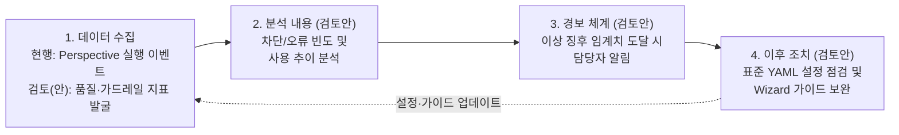
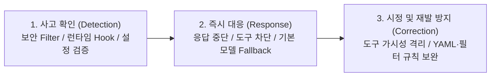

# [Slide 22 & 23] 유지보수 프로세스 및 AI Governance 최종 작성안

---

## 1. [Slide 22] 3. 유지보수 프로세스

### 📄 [Slide 22 슬라이드 본문]

#### **• AI 에이전트 Life Cycle 관리 체계**
* **AI 모델 Life Cycle**: 모든 모델 호출은 사내 `LiteLLM`을 경유하며, 전문가 에이전트 YAML에서 Step별 모델을 지정·관리
* **데이터 Life Cycle**:
  * **세션 산출물**: 실행 산출물(`Memory·Dashboard·Diary` 3계층)을 로컬 세션별로 분리 보관 (향후 이전 Task 기록 재활용을 통한 실행 시간 단축 검토)
  * **에이전트 YAML**: 사용자 정의 전문가 에이전트 YAML을 사내 GitHub Repo에 수집·버전 관리 체계 검토 중

#### **• 운영 모니터링**
* **[현행 (릴리즈 초기)]** 초기 활용도 파악을 위해 **Perspective별 실행 이벤트(사용 빈도 통계)**를 텔레메트리 수집 서버에 전송 중
* **[향후 검토]** **품질·가드레일 지표 발굴 및 [수집 → 분석 → 경보 → 조치] 운영 모니터링 체계 검토** *(※ 후보 지표의 수집·측정 가능 여부는 추후 확인 예정)*

아래 다이어그램은 현재의 기본 실행 이벤트 수집 단계에서 향후 품질·가드레일 지표를 발굴하여 확장하고자 하는 [수집 → 분석 → 경보 → 조치] 체계 검토(안)를 나타냅니다.

| 단계 | 구분 | 품질·가드레일 지표 발굴 및 [수집 → 분석 → 경보 → 조치] 체계 검토(안) *(※ 수집·측정 가능 여부 추후 확인)* |
| :--- | :--- | :--- |
| **1. 수집** *(현행 → 검토안)* | **현행 (릴리즈 초기)** | • **Perspective별 실행 이벤트 수집**: 에이전트 호출 여부 및 사용 빈도 통계를 사내 텔레메트리 서버로 전송 |
| | **지표 발굴·확대(안)** | • *(수집·측정 가능 여부 확인 필요)* 비인가 도구 차단 횟수, 미지원 모델 Fallback 발생 건수, 실행 중 에러 종료 여부, Token 사용량(`Langfuse` 연계) 등 후보 지표 발굴·검토 |
| **2. 분석 내용** *(검토안)* | **제어·보안 지표(안)** | • 에이전트별 비인가 도구(`allowed_tools` 외) 호출 차단 빈도 및 인프라 보안 필터 차단 발생 추이 확인 |
| | **활용·안정성 지표(안)** | • Perspective별 사용 추이, 실행 중 비정상 오류/중단 비율, Step별 평균 소요 시간 및 Token 소모량 추이 확인 |
| **3. 경보 내용** *(검토안)* | **이상 징후 알림(안)** | • **[제어/보안]** 비인가 도구 호출 시도 급증 또는 인프라 보안 필터 위반 임계치 초과 시 알림 검토 • **[안정성/자원]** 특정 에이전트 실행 오류율 급증 또는 비정상적 Token 과다 소모(무한 루프 등) 감지 시 알림 검토 |
| **4. 이후 조치** *(검토안)* | **점검 및 가이드 보완(안)** | • 이상 징후가 발생한 에이전트 유형에 대해 **사내 개발 환경에서 재현·점검 수행** • 필요 시 **기본 제공 에이전트 YAML(프롬프트·`allowed_tools`·권장 모델) 수정 배포 및 Wizard 생성 가이드 보완** |

---
---

## 2. [Slide 23] 3. AI Governance

### 💡 반영 포인트
* 앞 페이지(p.22) 및 하단 표와 중복되던 첫 번째 불릿 꼭지(`모든 모델 호출은 사내 LiteLLM 경유...`)를 과감히 제거하고,
* 심사위원이 요청한 2가지 핵심 주제(**① AI 산출물 Risk 관리 대책**, **② 주요 위험별 사고 확인 · 즉시 대응 · 시정 절차**)로만 슬라이드를 큼직하고 가독성 높게 구성했습니다. (기존 첫 번째 꼭지의 핵심 키워드였던 `LiteLLM/Langfuse`, `보안 Filter 개인정보 차단`, `CON-02 사내망 외부 전송 차단 및 가드레일 프롬프트`는 이미 아래 두 표 안에 자연스럽게 다 녹아 있습니다!)

---

### 📄 [Slide 23 슬라이드 본문]

#### **• AI 산출물(전문가 에이전트 YAML · 세션 산출물) Risk 관리 대책**
| AI 산출물 구분 | 잠재적 Risk (운영 및 확산 관점) | 기술적 안전장치 및 운영 Risk 관리 대책 |
| :--- | :--- | :--- |
| **1. 전문가 에이전트 정의서** *(사용자 정의 YAML 파일)* | • 스키마 오류 또는 과도한 도구 권한(`allowed_tools`)이 부여된 미검증 YAML이 생성·배포될 위험 | • **[시스템 통제]** Wizard 기반 스키마/모델 유효성 사전 검증 및 미지원 모델 지정 시 기본 모델 자동 Fallback • **[운영 관리]** 사내 GitHub 중앙 저장소(Repo)를 통한 전사 공유 시 **최소 권한 원칙(`allowed_tools`) 및 프롬프트 적정성 PR 검수 후 공식 등록** |
| **2. 에이전트 세션 산출물** *(`Memory·Dashboard·Diary`)* | • 실행 과정의 중간 기록·코드 맥락이 최종 에이전트 결과물(워크스페이스)에 혼입되거나 외부로 유출될 위험 | • **[세션 산출물과 에이전트 결과물 분리 저장]** 내부 실행 맥락 기록인 **세션 산출물(`~/.cline-sr/data/...`)**과 실제 작업 대상인 **에이전트 결과물(프로젝트 워크스페이스)**을 물리적으로 분리 저장하여 작업 영역 오염 및 Git 오커밋 원천 방지 • **[세션 격리 및 폐쇄망 보호]** 작업 폴더·Perspective·세션별 디렉터리 격리 보관 및 사내망 외부 전송 차단(CON-02, 필수 텔레메트리만 사내 고정 엔드포인트로 전송) |

---

#### **• 주요 위험별 사고 확인 · 즉시 대응 · 시정 절차**

아래 다이어그램은 AI 에이전트 운영 중 주요 위험 발생 시 탐지(사고 확인)부터 즉각 차단, 시정 및 재발 방지까지의 대응 절차를 나타냅니다.

| 주요 위험 시나리오 | 1) 사고 확인 (Detection) | 2) 즉시 대응 절차 (Response) | 3) 시정 및 재발방지 절차 (Correction) |
| :--- | :--- | :--- | :--- |
| **위험 A. 개인정보·기밀 입력 및 보안 위배 프롬프트 유입** | • 사내 `LiteLLM` 연동 `App Serving 보안 Filter` 실시간 탐지 및 `Langfuse` 위반 로그 기록 | • 개인정보(비밀번호·토큰 등) 입력 즉시 차단, 공격/악성코드 요청 거부 및 위반 응답 중단 | • 신규 위반 패턴을 인프라 보안 필터 규칙 및 클라이언트 사내 가드레일 프롬프트(CON-02)에 업데이트 |
| **위험 B. 에이전트의 비인가 도구 호출 시도 (권한 일탈)** | • 에이전트 실행 중 런타임 훅(`beforeTool`)에서 `allowed_tools` 외 도구 호출 시도 감지 | • 비인가 도구 실행 **100% 차단** 및 허용된 도구 범위 내 **대안 제시**로 안전 유도 | • **[도구 가시성 원천 격리]** `ToolVisibilityPolicy`로 LLM 프롬프트(`filtered tools[]`)에서 비인가 도구 명세 사전 배제 • **[배포 검수 강화]** 사내 Repo 공유 YAML의 역할별 허용 도구(`allowed_tools`) 최소 권한 검수 강화 |
| **위험 C. 에이전트 YAML 설정 오류 (미지원 모델 지정 등)** | • 에이전트 로드·실행 시 사내 지원 목록 외 모델명 지정 또는 스키마 오류 감지 | • 미지원 모델 지정 시 에러 중단 없이 **사내 기본(Default) 모델로 100% 자동 Fallback 발동** | • 수동 편집 대신 **에이전트 정의 Wizard** 사용을 표준화하여 유효 모델 선택 및 스키마 사전 검증 강제 |
