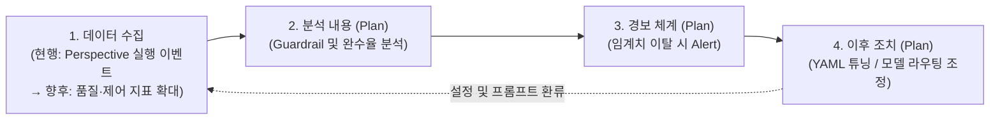
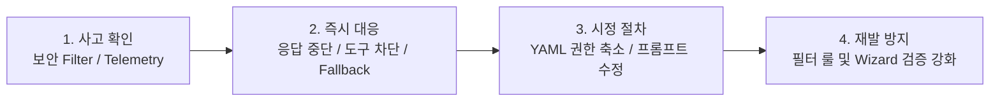

# [Slide 22 & 23] 유지보수 프로세스 및 AI Governance 작성안

---

## 1. [Slide 22] 3. 유지보수 프로세스

### 💡 반영 포인트
1. **1번(모델·데이터 Life Cycle) 대폭 축소**: 불필요한 세부 디렉터리 경로(`~/.cline-sr/data/...`)나 부연 설명을 빼고 **핵심 운영 방식만 각 1~2줄**로 간결하게 압축했습니다.
2. **2번(운영 모니터링) '현행(릴리즈 초기) + 향후 수집·분석·조치 계획' 뉘앙스 적용**: 현재는 **릴리즈 초기 단계라 Perspective별 실행 이벤트(얼마나 사용되는지)만 수집 중**임을 명확히 밝히고, 심사위원이 코멘트한 **`어떤 데이터를 추가 수집하여 분석하고, 어떻게 경보·조치할지`**를 **운영 모니터링 고도화 계획(Plan)**으로 자연스럽게 풀어냈습니다.

---

### 📄 [Slide 22 슬라이드 본문]

#### **• AI 에이전트 Life Cycle 관리 체계** *(간결화)*
* **AI 모델 Life Cycle**: 모든 모델 호출은 사내 `LiteLLM`을 경유하며, 전문가 에이전트 YAML에서 Step별 모델을 지정·교체 (코드 수정 불필요)
* **데이터 Life Cycle**:
  * **세션 산출물**: 실행 산출물(`Memory·Dashboard·Diary` 3계층)을 세션별로 분리 보관 (향후 이전 Task 기록을 재활용하여 실행 시간 단축 검토)
  * **에이전트 YAML**: 사용자 정의 전문가 에이전트 YAML을 사내 GitHub Repo에 수집·버전 관리 체계 검토 중

#### **• 운영 모니터링 현황 및 고도화 계획 (Guardrail 지표 기반)**
* **[현행 (릴리즈 초기)]** 초기 에이전트 활용도 파악을 위해 **Perspective별 실행 이벤트(사용 빈도 통계)**를 텔레메트리 서버로 수집 중
* **[향후 계획]** 사내 확산에 맞춰 **가드레일(Guardrail) 관련 수집 데이터를 구체화**하고, **분석 → 경보 → 사후 조치**로 이어지는 모니터링 체계 단계적 적용 계획

아래 다이어그램은 릴리즈 초기 기본 사용량 수집에서 출발하여 향후 분석·경보·사후 조치로 확장되는 운영 모니터링 계획을 나타냅니다.

| 단계 | 구분 | 상세 내용 (`현행` 및 `향후 고도화 계획`) |
| :--- | :--- | :--- |
| **1. 수집** *(현행 → 확대 계획)* | **현행 (릴리즈 초기)** | • **Perspective별 실행 이벤트 수집**: 에이전트별 호출 빈도 및 사용량 통계를 텔레메트리 수집 서버로 전송 |
| | **추가 수집 계획** | • **품질·가드레일 지표 수집 확대 검토**: Step별 Verification 통과 여부, 비인가 도구 차단 이벤트, Fallback 발생 빈도, Token 사용량 (`Langfuse` 연계) |
| **2. 분석 내용** *(수립 계획)* | **제어·보안 가드레일** | • 에이전트별 비인가 도구(`allowed_tools` 외) 호출 시도 빈도 및 인프라 보안 필터 차단 로그 분석 |
| | **품질·효율성 지표** | • 전문가 에이전트별 **작업 완수율(Step 통과율)** 추이, Context 초과 빈도 및 모델별 응답 지연/오류율 분석 |
| **3. 경보 내용** *(수립 계획)* | **즉시 경보 (Critical)** | • 비인가 도구 연속 호출 감지 시, 특정 LLM 모델 연속 응답 실패(Fallback 임계치 도달) 시 관리자 알림 |
| | **주의 경보 (Warning)** | • 특정 에이전트(YAML)의 **Step 완수율이 목표치(90%) 미만으로 하락**하거나 Step당 Token 소모 급증 시 알림 |
| **4. 이후 조치** *(수립 계획)* | **모델/인프라 조치** | • 장애·지연 모델에 대해 `LiteLLM` 라우팅 가중치 조정 및 에이전트 YAML 내 권장/Fallback 모델 변경 |
| | **에이전트(YAML) 조치** | • 완수율 저하 에이전트의 실패 세션(`Diary`)을 분석하여 **Step 분할 조정, 프롬프트 개선, 허용 도구 권한 축소** 후 배포 |

---
---

## 2. [Slide 23] 3. AI Governance

### 💡 반영 포인트
* 템플릿 지침(**데이터 / 모델 / Compliance**)을 유지하면서, 심사위원 코멘트인 **① 주요 위험별 대응절차(사고 확인 → 대응 → 시정)**와 **② AI 산출물 Risk 관리 대책**을 한눈에 보이도록 표로 정리했습니다.

---

### 📄 [Slide 23 슬라이드 본문]

#### **• 사내 폐쇄형 AI Governance 3대 체계 (데이터 · 모델 · Compliance)**
* **[데이터] 수집 적법성 · 개인정보 침해 방지 · 편향성 검토**
  * **수집 적법성**: 클라이언트 Telemetry는 필터로 필수 항목만 사내 고정 엔드포인트로 전송, 인프라 로그는 `LiteLLM → Langfuse` 사내망 내부 적재
  * **개인정보 침해 2중 방지**: ① **[클라이언트]** 사내망 외부 전송 차단(CON-02) + ② **[인프라 보안 Filter]** 비밀번호·토큰 등 개인정보 입력 실시간 차단
  * **편향성 검토**: Wizard(QAS-04) 기반 표준 YAML 스키마 검증으로 설정 오류를 방지하고, Step별 다중 모델 지정으로 특정 모델 편중 완화
* **[모델] 투명성 및 책임성 (XAI & Accountability)**
  * **투명성(XAI)**: 에이전트 수행 과정을 `Memory·Dashboard·Diary` 3계층으로 기록하고, 선언적 YAML을 통해 실행 Step과 허용 도구를 명확히 가시화
  * **책임성(Accountability)**: `Custom Auth` 및 `Langfuse` 연동을 통해 사용자·Perspective·Step 단위의 모델 호출 및 도구 실행 이력 추적
* **[Compliance] 국내외 가이드라인 및 사내 규정 준수**
  * 외부 AI 도구 사용 불가 환경 대응 폐쇄망 구조 및 사내 가드레일 프롬프트 강제 적용(CON-02), 인간 개입 통제(Human-in-the-Loop) 원칙 준수

#### **• AI 산출물(코드 · 명령 · 설정) Risk 관리 대책** *(★심사위원 코멘트 반영 1)*
| 단계 | AI 산출물 주요 Risk | `Cline^SR` 클라이언트 및 인프라 Risk 통제 대책 |
| :--- | :--- | :--- |
| **사전 예방** | **에이전트 설정(YAML) 오류 및 누락** | • **Wizard 기반 스키마 검증(QAS-04)**: 수동 편집 시 발생하는 모델명 오류, `allowed_tools` 누락을 생성 단계에서 사전 차단 |
| **실행 통제** | **비인가 파일 수정 및 위험 명령 실행** | • **런타임 도구 권한 강제(QAS-01)**: Read-Only 등 허용된 도구 외 비인가 도구 호출 100% 차단 + 코드 반영 전 **개발자 승인(Human-in-the-Loop)** |
| **사후 검증** | **부정확 산출물(환각) 및 악성 응답** | • **Step 분할 Verification(QAS-02)**: 단계별 검증(테스트·커버리지) 통과 시에만 진행 + **인프라 보안 Filter**로 악성코드 요청 거부 및 위반 응답 중단 |

#### **• 주요 위험별 사고 확인 · 대응 · 시정 절차** *(★심사위원 코멘트 반영 2)*

아래 다이어그램은 AI 운영 중 주요 위험 발생 시 사고 확인부터 즉시 차단, 시정 조치, 재발 방지로 이어지는 대응 절차를 나타냅니다.

| 주요 위험 시나리오 | 1) 사고 확인 (Detection) | 2) 즉시 대응 절차 (Response) | 3) 시정 및 재발방지 절차 (Correction) |
| :--- | :--- | :--- | :--- |
| **개인정보·기밀 노출 및 위반 프롬프트 유입** | • `App Serving 보안 Filter` 실시간 감지 및 `Langfuse` 위반 로그 확인 | • 해당 추론 요청 즉시 거부 및 위반 응답 스트리밍 강제 중단 | • 위반 패턴을 인프라 보안 필터 및 사내 가드레일 프롬프트 규칙에 추가 반영 |
| **에이전트의 비인가 도구 호출 시도 (권한 일탈)** | • `Cline^SR` 런타임 도구 제어기에서 `allowed_tools` 위반 호출 감지 | • 도구 실행 즉시 차단(100% Block) 및 에이전트에 안전 대안 제시(QAS-01) | • 해당 세션 `Diary` 점검 후 에이전트 YAML의 Step 지시문 및 허용 도구 명세 시정 |
| **특정 모델 이상 응답 및 Step 검증 연속 실패** | • Step Verification 실패 또는 모델 응답 오류 확인 | • 런타임 **Fallback 모델로 즉시 전환(QAS-03)** 또는 사용자 수동 개입 전환 | • 문제 모델 `LiteLLM` 라우팅 점검(SR-DI팀 협업) 및 YAML 권장 모델 갱신 |
