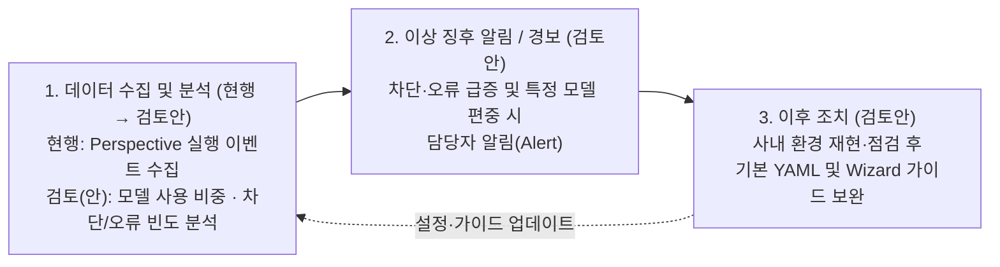
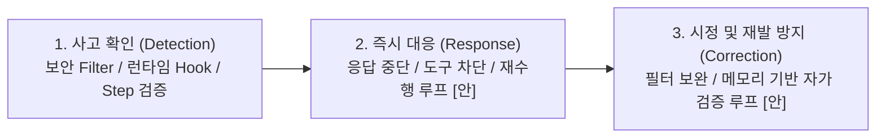

# [Slide 22 & 23] 유지보수 프로세스 및 AI Governance 최종 작성안

---

## 1. [Slide 22] 3. 유지보수 프로세스

### 📄 [Slide 22 슬라이드 본문]

#### **• AI 에이전트 Life Cycle 관리 체계**
* **AI 모델 Life Cycle**: 모든 모델 호출은 사내 `LiteLLM`을 경유하며, 전문가 에이전트 YAML에서 Step별 모델을 지정·관리
* **데이터 Life Cycle**:
  * **세션 산출물**: 실행 산출물(`Memory·Dashboard·Diary` 3계층)을 로컬 세션별로 분리 보관 — **세션 리뷰(Resume) 시 세션 내 데이터를 재활용하여 중단·후속 작업 이어서 수행 가능** (향후 타 세션/이전 Task 데이터까지 교차 활용 검토)
  * **에이전트 YAML**: 사용자 정의 전문가 에이전트 YAML을 사내 GitHub Repo에 수집·버전 관리 체계 검토 중

#### **• 운영 모니터링**
* **[현행 (릴리즈 초기)]** 초기 활용도 파악을 위해 **Perspective별 실행 이벤트(사용 빈도 통계)**를 텔레메트리 수집 서버에 전송 중
* **[향후 검토]** **품질·가드레일 지표 발굴 및 `[데이터 수집·분석 → 이상 징후 알림(경보) → 이후 조치]` 체계 검토** *(※ 후보 지표의 수집·측정 가능 여부는 추후 확인 예정)*

아래 다이어그램은 현재의 기본 실행 이벤트 수집에서 출발하여 향후 품질·가드레일 지표를 발굴·모니터링하는 3단계 운영 체계 검토(안)를 나타냅니다.

| 단계 | 구분 | 품질·가드레일 지표 발굴 및 [수집·분석 → 징후 알림 → 조치] 체계 검토(안) *(※ 수집·측정 가능 여부 추후 확인)* |
| :--- | :--- | :--- |
| **1. 데이터 수집 및 분석** *(현행 → 검토안)* | **현행 (릴리즈 초기)** | • **Perspective별 실행 이벤트 수집**: 에이전트 호출 여부 및 사용 빈도 통계를 사내 텔레메트리 수집 서버로 전송 |
| | **지표 발굴 및 분석(안)** | • **[모델·활용 분석]** **Step별 어떤 모델이 많이 쓰였는지(모델별 사용 비중 및 특정 모델 쏠림 여부)**, 미지원 모델 Fallback 발생 빈도, 실행 중 에러 종료 비율 확인 • **[제어·보안 분석]** 에이전트별 비인가 도구(`allowed_tools` 외) 호출 차단 빈도 및 인프라 `보안 Filter` 차단 추이 확인 |
| **2. 이상 징후 알림 (경보)** *(검토안)* | **알림 기준(안)** | • **[제어/보안 징후]** 비인가 도구 호출 시도 급증 또는 인프라 보안 필터 위반 임계치 초과 시 담당자 알림(Alert) 검토 • **[모델/안정성 징후]** 특정 모델로의 과도한 호출 편중(또는 미지원 모델 Fallback 다발), 특정 에이전트 오류율·Token 급증 시 알림 검토 |
| **3. 이후 조치** *(검토안)* | **점검·가이드 보완(안)** | • 이상 징후 발생 에이전트에 대해 사내 개발 환경에서 재현·점검 수행 및 **Step 특성별 최적 모델 매핑 가이드 조정** • 필요 시 **기본 제공 에이전트 YAML(프롬프트·`allowed_tools`·권장 모델) 수정 배포 및 Wizard 생성 가이드 보완** |

---
---

## 2. [Slide 23] 3. AI Governance

### 📄 [Slide 23 슬라이드 본문]

#### **• AI 산출물(전문가 에이전트 YAML · 세션 산출물) Risk 관리 대책**
| AI 산출물 구분 | 잠재적 Risk (운영 및 확산 관점) | 기술적 안전장치 및 운영 Risk 관리 대책 |
| :--- | :--- | :--- |
| **1. 전문가 에이전트 정의서** *(사용자 정의 YAML 파일)* | • 수동 편집으로 인한 설정 오류(`allowed_tools` 누락·모델 오기재), 과도한 권한 부여 및 **비표준 YAML 파편화**로 에이전트 품질·안전성이 저하될 위험 | • **[시스템 통제]** Wizard 기반 표준 규격 생성·스키마 사전 검증(QAS-04) 및 미지원 모델 지정 시 기본 모델 자동 Fallback(QAS-03) • **[운영 관리]** 검증 완료된 **사내 공식 기본 에이전트(Built-in YAML, 수정 보호)**와 개발자가 추가하는 **사용자 정의 에이전트(Custom YAML) 영역을 분리 운영**하여 기본 에이전트 오염 방지 |
| **2. 에이전트 세션 산출물** *(`Memory·Dashboard·Diary`)* | • 실행 과정의 중간 기록·코드 맥락이 최종 에이전트 결과물(워크스페이스)에 혼입되어 작업 영역을 오염시킬 위험 | • **[세션 산출물과 에이전트 결과물 분리 저장]** 내부 실행 맥락 기록인 **세션 산출물(`~/.cline-sr/data/...`)**과 실제 작업 대상인 **에이전트 결과물(프로젝트 워크스페이스)**을 물리적으로 분리 저장하여 작업 영역 오염 및 Git 오커밋 원천 방지 |

---

#### **• 주요 위험별 사고 확인 · 즉시 대응 · 시정 절차**

아래 다이어그램은 AI 에이전트 운영 중 주요 위험 발생 시 탐지(사고 확인)부터 즉각 차단, 시정 및 재발 방지(향후 고도화 포함)까지의 대응 절차를 나타냅니다.

| 주요 위험 시나리오 | 1) 사고 확인 (Detection) | 2) 즉시 대응 절차 (Response) | 3) 시정 및 재발방지 절차 (Correction) |
| :--- | :--- | :--- | :--- |
| **위험 A. 개인정보·기밀 입력 및 보안 위배 프롬프트 유입** | • 사내 `LiteLLM` 연동 `App Serving 보안 Filter` 실시간 탐지 및 `Langfuse` 위반 로그 기록 | • 개인정보(비밀번호·토큰 등) 입력 즉시 차단, 공격/악성코드 요청 거부 및 위반 응답 중단 | • 신규 위반 패턴을 인프라 보안 필터 규칙 및 클라이언트 사내 가드레일 프롬프트(CON-02)에 업데이트 |
| **위험 B. 불완전 YAML 정의로 인한 Goal 미달성 위험** | • 런타임 훅(`beforeTool`)에서 `allowed_tools` 외 비인가 도구 호출 시도 실시간 감지 • **`[안]` 실행 중 Step Self-Verification 실패 또는 세션 `dashboard.md` 리뷰를 통한 작업 미완수 확인** | • 비인가 도구 실행 **100% 차단** 및 허용된 도구 범위 내 **대안 제시**로 안전 유도(QAS-01) • **`[안]` 검증 미통과 시 `diary.md` 피드백 기반 재수행 루프(Retry Loop) 가동 또는 미완수 기록** | • **`[안]` 세션 메모리(`diary.md`·`Mailbox`) 기반 의미론적 Self-Verification 루프**:   - 실행 중 기록된 **`diary.md`(도구 권한 상충으로 인한 미완수 내역)** 및 **`Mailbox`(권한·지시 상충 관련 `QUESTION` 기록)**를 바탕으로 Step 프롬프트와 `allowed_tools` 간 불일치(과다 허용·필수 도구 누락)를 자가 검증하여 **YAML의 도구 권한 조정 및 Step 분리를 보정·업데이트하는 루프 적용** |

> `※ [안] 표기 항목: 향후 적용 가능성 검토 중`
